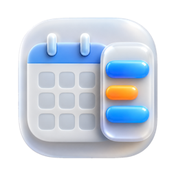

<p align="center"></p>

<h1 align="center">SideCal</h1>

<p align="center"><b>A free sidebar calendar for macOS.</b><br>Your whole day on the edge of your screen. Time-block by dragging. See your next event in the menu bar.</p>

<p align="center">
<a href="https://github.com/kacpergorec/sidecal/releases/latest"><b>Download</b></a> ·
<a href="https://kacpergorec.github.io/sidecal/">Website</a> ·
<a href="https://kacpergorec.github.io/sidecal/documentation.html">Docs</a>
</p>

<p align="center">
<a href="https://github.com/kacpergorec/sidecal/releases/latest"></a>
<a href="https://github.com/kacpergorec/sidecal/releases"></a>
<a href="https://github.com/kacpergorec/sidecal/stargazers"></a>
<a href="LICENSE"></a>


</p>

- **No telemetry.**
- **No network code.** SideCal never talks to the internet.
- **Built in Rust.**
- **Local only.** It reads your calendar through Apple's EventKit.
- **No account, no analytics, no Electron.**

## Features

- **24 hours, always in view.** The whole day fits the screen with a live "now" line. No scrolling.
- **Time-block by dragging.** Drag to create an event, drag an entry to move it, drag its edge to resize. Snaps to 15 minutes and saves to Apple Calendar.
- **Auto-hide.** The sidebar slides off the screen edge when you move away and comes back when you touch the edge. Left or right side.
- **Edge preview.** While hidden it leaves a thin, faded strip of your day.
- **Menu bar countdown.** "Design review (23m left)" while an event runs, "Standup in 12m" before the next one.
- **Works with every calendar** in the macOS Calendar app: iCloud, Google, Exchange, CalDAV.
- **Looks native.** Light, dark or follow macOS. Twelve colours, island mode, highlight for the running event.
- **Yours to arrange.** Recolour calendars and events, set calendar priority, hide single events from the sidebar.
- **Global shortcuts** to show the sidebar, add an event or open settings.
- **Tiny.** A single native binary of about 7 MB. No background services.

## Install

### Option 1: download (no tools needed)

1. Get the latest **SideCal-apple-silicon.zip** (M1 and newer) or **SideCal-intel.zip** from [Releases](https://github.com/kacpergorec/sidecal/releases/latest).
2. Unzip it and drag **SideCal.app** to **Applications**.
3. First launch: right-click the app, choose **Open**, then **Open** again. The app is not notarized with an Apple Developer ID, so macOS asks once.
4. Allow calendar access when asked.

If macOS says the app is damaged, run `xattr -dr com.apple.quarantine /Applications/SideCal.app`.

### Option 2: build from source

Needs macOS 14+, the Xcode Command Line Tools (`xcode-select --install`) and [Rust](https://rustup.rs).

```bash
git clone https://github.com/kacpergorec/sidecal.git
cd sidecal
./install.sh
```

The first build takes a few minutes. `./build-app.sh` builds `SideCal.app` without installing it.

## Privacy

SideCal has no network code and no telemetry. Events are read through EventKit and stay in your calendar. Its own settings live in one JSON file on your Mac. You can verify this: the source is short and has no HTTP client.

## Contributing

See [CONTRIBUTING.md](CONTRIBUTING.md).

## License

[Apache 2.0](LICENSE). Keep the [NOTICE](NOTICE) file. Copyright 2026 Kacper Górec.
